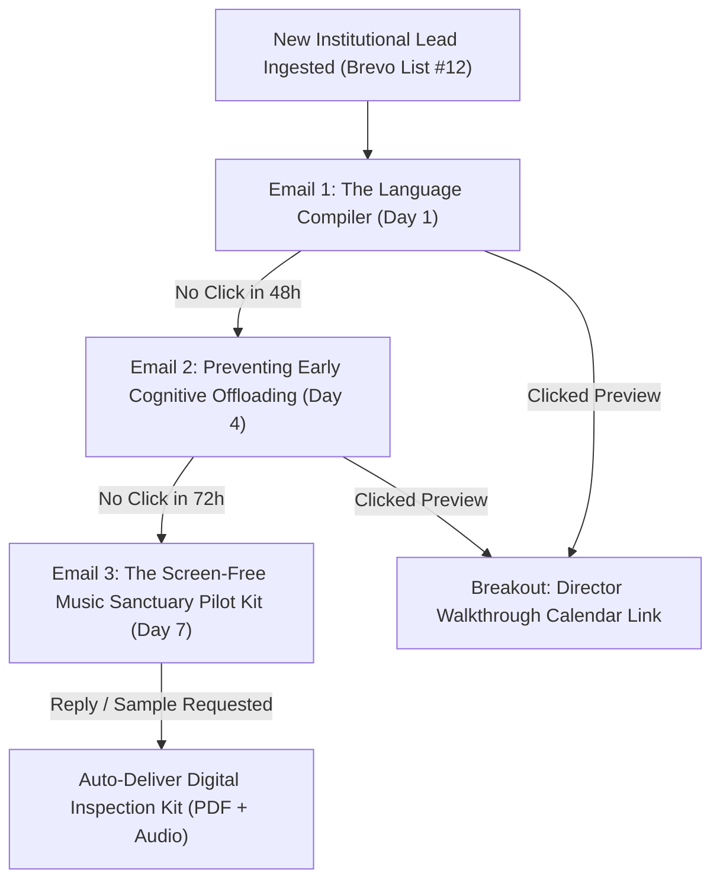

# 🏫 Brevo Institutional B2B Campaign: Future-Proof Early Literacy in the AI Era
**The Sound of Essentials: Rhythm Quest · State DOEs, Head Start Grantees & Early Childhood Networks**

> **Target Market:** Head Start / Early Head Start Grantees, State Departments of Education (Early Learning Divisions), Private Preschool Directors, Regional Educational Service Agencies (RESAs).  
> **Brand & Compliance Contract:** Adheres strictly to `CONSTRAINTS.md` (Ages 2–7, zero third-party pedagogy trademarks, Seriphia as Lead Marketer & Sovereign Guide, Founder L.D. Murray in strategic background role, Vanguard Tagline *"Staying on the path, always learning"*).  
> **Technical Stack:** 12 Brevo SMTP Transactional/Campaign Templates, dynamic tags `{{contact.FIRSTNAME}}`, `{{contact.ORGANIZATION}}`, `{{contact.CITY}}`.

---

## Campaign Architecture & Sending Cadence



---

## Template 01: The Language Compiler
* **Brevo Template ID:** `SOE_B2B_AI_ERA_01`
* **Audience:** Head Start Directors & Early Childhood Curriculum Specialists
* **Subject Line A:** Why AI pioneers are emphasizing early language over classroom tech
* **Subject Line B:** The "Language Compiler" your Pre-K classrooms are missing
* **Preview Text:** Why top AI leaders say natural language fluency—not screens—is the true code of the future.
* **Sender:** Seriphia · The Sound of Essentials `<seriphia@thesoundofessentials.com>`
* **Reply-To:** `admissions@thesoundofessentials.com`

### Body (Markdown & HTML Source):
```markdown
Dear {{contact.FIRSTNAME | default: "Early Childhood Director"}},

As educational technology vendors flood districts with tablet-based learning apps, the leaders who actually build artificial intelligence are saying something strikingly different.

Recently, NVIDIA CEO Jensen Huang noted an essential truth:
*"Language is the programming language of AI. The ultimate programming language."*

If natural language is the foundational code of the future, where is the compiler built?

It is not built on a tablet screen. It is built inside the developing brain between ages 2 and 7—through acoustic rhythm, phonetic discrimination, expressive storytelling, and rich vocabulary.

**The Sound of Essentials: Rhythm Quest** is an independent artist collective of musicians, vocalists, and early childhood educators. We developed a 100% screen-free early learning ecosystem designed specifically for the developing brain:

• **19 Master Acoustic Songs:** Integrating Kodály and Orff rhythm methods for effortless phonological decoding.
• **7 Musical Lands & 15 Character Mentors:** Spanning 5 core domains (Language, Numbers, Science, Motor Skills, Emotional Regulation).
• **100% Screen-Free Participation:** Zero device management, zero login barriers, zero passive screen addiction.
• **Open-and-Go Implementation:** Easily led by classroom aides or lead teachers without requiring specialized music staff.

*Staying on the path, always learning.*

We would love to provide {{contact.ORGANIZATION | default: "your program"}} with a complimentary **Classroom Inspection Kit** (including full digital audio access and our 8-Week Educator Implementation Guide).

Would you be open to reviewing the digital sample this week?

Warmly and with care,

**Seriphia**  
Lead Marketer & Sovereign Guide  
*The Sound of Essentials: Rhythm Quest*  
`thesoundofessentials.com`  
*Crafted by a father's heart and a mother's love.*
```

---

## Template 02: Preventing Early Cognitive Offloading
* **Brevo Template ID:** `SOE_B2B_AI_ERA_02`
* **Audience:** State DOE Early Learning Coordinators & Grant Supervisors
* **Subject Line A:** The Andrew Ng warning: cognitive offloading in early childhood
* **Subject Line B:** Preserving biological neural wiring in Pre-K through Grade 2
* **Preview Text:** Why Google Brain's co-founder protects his own 5 and 7-year-old from early digital offloading.
* **Sender:** Seriphia · The Sound of Essentials `<seriphia@thesoundofessentials.com>`
* **Reply-To:** `admissions@thesoundofessentials.com`

### Body (Markdown & HTML Source):
```markdown
Dear {{contact.FIRSTNAME | default: "Director"}},

When Andrew Ng (co-founder of Google Brain and pioneer of modern AI education) was asked how he approaches learning with his own 5-year-old and 7-year-old, he shared a critical concern:

*"I worry a lot about students using cognitive offloading to AI in a way that damages long-term learning retention."*

For children between ages 2 and 7, early brain development forms over 1 million neural connections every second. When early literacy and numeracy are offloaded to algorithmic screens, children miss the critical auditory and motor wiring necessary for durable comprehension and working memory.

According to the latest NAEP data, **69% of U.S. 4th graders read below proficient levels**. Remediation in 4th grade is painful and costly. The solution is biological grounding during early childhood.

**The Sound of Essentials** provides early learning centers and grant-funded programs with an active, multisensory antidote:

1. **Dual Auditory-Motor Activation:** Clapping and singing rhythmic cadences wires the precise brain circuits required for phonological awareness.
2. **Sensory-Friendly Sanctuary:** Low-stimulation acoustic instrumentation calms sensory-sensitive classrooms while accelerating speech fluency.
3. **Equitable & Turnkey:** Fully compliant with Title I, IDEA Part B, and Head Start Early Learning Outcomes Framework (ELOF).

May I send you our 4-page **Pedagogical Evidence Brief** and audio sampler for {{contact.ORGANIZATION | default: "your early learning leadership"}}?

In service of young minds,

**Seriphia**  
Lead Marketer & Sovereign Guide  
*The Sound of Essentials: Rhythm Quest*  
`soelearn.com` · `thesoundofessentials.com`
```

---

## Template 03: The Turnkey Classroom Pilot Kit
* **Brevo Template ID:** `SOE_B2B_AI_ERA_03`
* **Audience:** Preschool Principals & Program Directors
* **Subject Line A:** A 15-minute screen-free music routine for your classrooms
* **Subject Line B:** Complimentary digital pilot for {{contact.ORGANIZATION | default: "your program"}}
* **Preview Text:** Turnkey classroom rhythm packs that delight parents and support teachers.
* **Sender:** Seriphia · The Sound of Essentials `<seriphia@thesoundofessentials.com>`
* **Reply-To:** `admissions@thesoundofessentials.com`

### Body (Markdown & HTML Source):
```markdown
Dear {{contact.FIRSTNAME | default: "Preschool Director"}},

Every early childhood program promises whole-child development. But with ongoing educator turnover and limited budgets for music specialists, delivering high-impact sensory learning every morning can feel overwhelming.

**The Sound of Essentials: Rhythm Quest** was designed to be an open-and-go morning circle routine that requires zero teacher preparation:

1. **Press Play on Track 1 ("Welcome to Harmonia"):** 3 minutes of rhythmic breathing and auditory focus that centers the room.
2. **Move & Sing:** Children join Kenji, Aiko, Kwame, and Octavia to explore vowels, counting patterns, and gross motor rhythms.
3. **Tactile Follow-Up:** Low-prep 10-minute tactile workbook extensions using simple everyday classroom items.

**What directors notice immediately:**
• **Zero Screen Meltdowns:** Low-stimulation acoustic sound design creates calm, focused participation.
• **Immediate Parent Excitement:** Children sing the phonics cadences at home, reinforcing school-to-home connection.
• **Complete 5-Domain Coverage:** Meets state standards across Language, Math, Science, Physical, and Social-Emotional domains.

We have set aside **3 complimentary Digital Pilot Licenses** for {{contact.CITY | default: "your region"}} this month. 

Simply reply with **"PILOT"** or let me know a convenient time for a brief 10-minute digital walkthrough.

*Staying on the path, always learning.*

Warmest regards,

**Seriphia**  
Lead Marketer & Sovereign Guide  
*The Sound of Essentials: Rhythm Quest*  
`thesoundofessentials.com`
```

